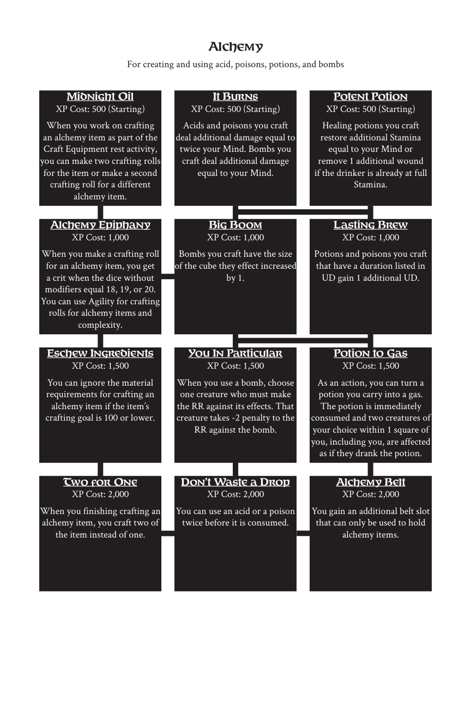

# Alchemy

> Source: Crows — Character Booklet, Playtest 3, PDF page(s) 8.

The diagram above preserves the prerequisite connections. Trait text follows in row order.

For creating and using acid, poisons, potions, and bombs

## Midnight Oil

**XP Cost:** 500 (Starting)

When you work on crafting an alchemy item as part of the Craft Equipment rest activity, you can make two crafting rolls for the item or make a second crafting roll for a different alchemy item.

## It Burns

**XP Cost:** 500 (Starting)

Acids and poisons you craft deal additional damage equal to twice your Mind. Bombs you craft deal additional damage equal to your Mind.

## Potent Potion

**XP Cost:** 500 (Starting)

Healing potions you craft restore additional Stamina equal to your Mind or remove 1 additional wound if the drinker is already at full Stamina.

## Alchemy Epiphany

**XP Cost:** 1,000

When you make a crafting roll for an alchemy item, you get a crit when the dice without modifiers equal 18, 19, or 20. You can use Agility for crafting rolls for alchemy items and complexity.

## Big Boom

**XP Cost:** 1,000

Bombs you craft have the size of the cube they effect increased by 1.

## Lasting Brew

**XP Cost:** 1,000

Potions and poisons you craft that have a duration listed in UD gain 1 additional UD.

## Eschew Ingredients

**XP Cost:** 1,500

You can ignore the material requirements for crafting an alchemy item if the item’s crafting goal is 100 or lower.

## You In Particular

**XP Cost:** 1,500

When you use a bomb, choose one creature who must make the RR against its effects. That creature takes -2 penalty to the RR against the bomb.

## Potion to Gas

**XP Cost:** 1,500

As an action, you can turn a potion you carry into a gas. The potion is immediately consumed and two creatures of your choice within 1 square of you, including you, are affected as if they drank the potion.

## Two for One

**XP Cost:** 2,000

When you finishing crafting an alchemy item, you craft two of the item instead of one.

## Don’t Waste a Drop

**XP Cost:** 2,000

You can use an acid or a poison twice before it is consumed.

## Alchemy Belt

**XP Cost:** 2,000

You gain an additional belt slot that can only be used to hold alchemy items.

---

[Index](00-index.md) · [Previous](05-traits.md) · [Next](07-alteration.md)
