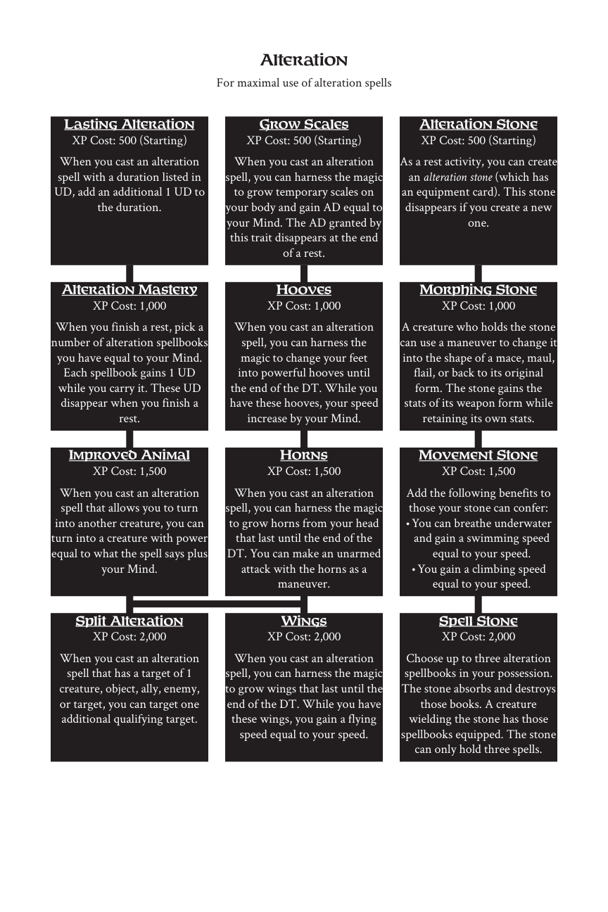

# Alteration

> Source: Crows — Character Booklet, Playtest 3, PDF page(s) 9.

The diagram above preserves the prerequisite connections. Trait text follows in row order.

For maximal use of alteration spells

## Lasting Alteration

**XP Cost:** 500 (Starting)

When you cast an alteration spell with a duration listed in UD, add an additional 1 UD to the duration.

## Grow Scales

**XP Cost:** 500 (Starting)

When you cast an alteration spell, you can harness the magic to grow temporary scales on your body and gain AD equal to your Mind. The AD granted by this trait disappears at the end of a rest.

## Alteration Stone

**XP Cost:** 500 (Starting)

As a rest activity, you can create an *alteration stone* (which has an equipment card). This stone disappears if you create a new one.

## Alteration Mastery

**XP Cost:** 1,000

When you finish a rest, pick a number of alteration spellbooks you have equal to your Mind. Each spellbook gains 1 UD while you carry it. These UD disappear when you finish a rest.

## Hooves

**XP Cost:** 1,000

When you cast an alteration spell, you can harness the magic to change your feet into powerful hooves until the end of the DT. While you have these hooves, your speed increase by your Mind.

## Morphing Stone

**XP Cost:** 1,000

A creature who holds the stone can use a maneuver to change it into the shape of a mace, maul, flail, or back to its original form. The stone gains the stats of its weapon form while retaining its own stats.

## Improved Animal

**XP Cost:** 1,500

When you cast an alteration spell that allows you to turn into another creature, you can turn into a creature with power equal to what the spell says plus your Mind.

## Horns

**XP Cost:** 1,500

When you cast an alteration spell, you can harness the magic to grow horns from your head that last until the end of the DT. You can make an unarmed attack with the horns as a maneuver.

## Movement Stone

**XP Cost:** 1,500

Add the following benefits to those your stone can confer:

- You can breathe underwater and gain a swimming speed equal to your speed.

- You gain a climbing speed equal to your speed.

## Split Alteration

**XP Cost:** 2,000

When you cast an alteration spell that has a target of 1 creature, object, ally, enemy, or target, you can target one additional qualifying target.

## Wings

**XP Cost:** 2,000

When you cast an alteration spell, you can harness the magic to grow wings that last until the end of the DT. While you have these wings, you gain a flying speed equal to your speed.

## Spell Stone

**XP Cost:** 2,000

Choose up to three alteration spellbooks in your possession. The stone absorbs and destroys those books. A creature wielding the stone has those spellbooks equipped. The stone can only hold three spells.

---

[Index](00-index.md) · [Previous](06-alchemy.md) · [Next](08-archery.md)
