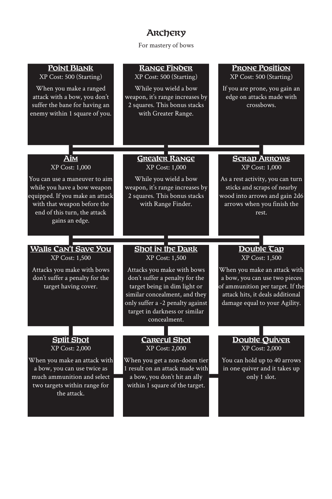

# Archery

> Source: Crows — Character Booklet, Playtest 3, PDF page(s) 10.

The diagram above preserves the prerequisite connections. Trait text follows in row order.

For mastery of bows

## Point Blank

**XP Cost:** 500 (Starting)

When you make a ranged attack with a bow, you don’t suffer the bane for having an enemy within 1 square of you.

## Range Finder

**XP Cost:** 500 (Starting)

While you wield a bow weapon, it’s range increases by 2 squares. This bonus stacks with Greater Range.

## Prone Position

**XP Cost:** 500 (Starting)

If you are prone, you gain an edge on attacks made with crossbows.

## Aim

**XP Cost:** 1,000

You can use a maneuver to aim while you have a bow weapon equipped. If you make an attack with that weapon before the end of this turn, the attack gains an edge.

## Greater Range

**XP Cost:** 1,000

While you wield a bow weapon, it’s range increases by 2 squares. This bonus stacks with Range Finder.

## Scrap Arrows

**XP Cost:** 1,000

As a rest activity, you can turn sticks and scraps of nearby wood into arrows and gain 2d6 arrows when you finish the rest.

## Walls Can’t Save You

**XP Cost:** 1,500

Attacks you make with bows don’t suffer a penalty for the target having cover.

## Shot in the Dark

**XP Cost:** 1,500

Attacks you make with bows don’t suffer a penalty for the target being in dim light or similar concealment, and they only suffer a -2 penalty against target in darkness or similar concealment.

## Double Tap

**XP Cost:** 1,500

When you make an attack with a bow, you can use two pieces of ammunition per target. If the attack hits, it deals additional damage equal to your Agility.

## Split Shot

**XP Cost:** 2,000

When you make an attack with a bow, you can use twice as much ammunition and select two targets within range for the attack.

## Careful Shot

**XP Cost:** 2,000

When you get a non-doom tier 1 result on an attack made with a bow, you don’t hit an ally within 1 square of the target.

## Double Quiver

**XP Cost:** 2,000

You can hold up to 40 arrows in one quiver and it takes up only 1 slot.

---

[Index](00-index.md) · [Previous](07-alteration.md) · [Next](09-armor.md)
