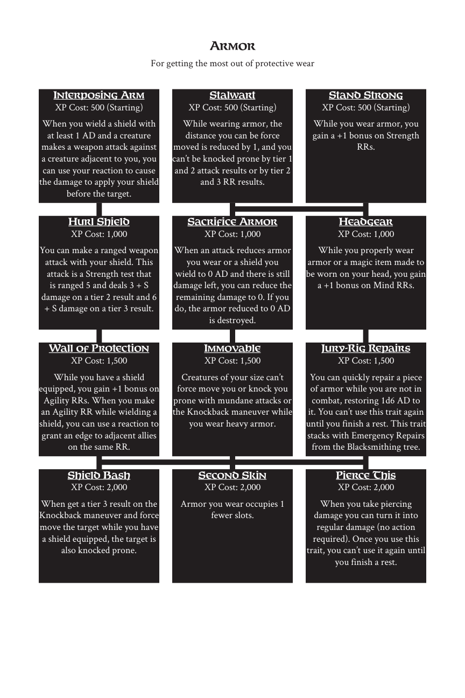

# Armor

> Source: Crows — Character Booklet, Playtest 3, PDF page(s) 11.

The diagram above preserves the prerequisite connections. Trait text follows in row order.

For getting the most out of protective wear

## Interposing Arm

**XP Cost:** 500 (Starting)

When you wield a shield with at least 1 AD and a creature makes a weapon attack against a creature adjacent to you, you can use your reaction to cause the damage to apply your shield before the target.

## Stalwart

**XP Cost:** 500 (Starting)

While wearing armor, the distance you can be force moved is reduced by 1, and you can’t be knocked prone by tier 1 and 2 attack results or by tier 2 and 3 RR results.

## Stand Strong

**XP Cost:** 500 (Starting)

While you wear armor, you gain a +1 bonus on Strength RRs.

## Hurl Shield

**XP Cost:** 1,000

You can make a ranged weapon attack with your shield. This attack is a Strength test that is ranged 5 and deals 3 + S damage on a tier 2 result and 6 + S damage on a tier 3 result.

## Sacrifice Armor

**XP Cost:** 1,000

When an attack reduces armor you wear or a shield you wield to 0 AD and there is still damage left, you can reduce the remaining damage to 0. If you do, the armor reduced to 0 AD is destroyed.

## Headgear

**XP Cost:** 1,000

While you properly wear armor or a magic item made to be worn on your head, you gain a +1 bonus on Mind RRs.

## Wall of Protection

**XP Cost:** 1,500

While you have a shield equipped, you gain +1 bonus on Agility RRs. When you make an Agility RR while wielding a shield, you can use a reaction to grant an edge to adjacent allies on the same RR.

## Immovable

**XP Cost:** 1,500

Creatures of your size can’t force move you or knock you prone with mundane attacks or the Knockback maneuver while you wear heavy armor.

## Jury-Rig Repairs

**XP Cost:** 1,500

You can quickly repair a piece of armor while you are not in combat, restoring 1d6 AD to it. You can’t use this trait again until you finish a rest. This trait stacks with Emergency Repairs from the Blacksmithing tree.

## Shield Bash

**XP Cost:** 2,000

When get a tier 3 result on the Knockback maneuver and force move the target while you have a shield equipped, the target is also knocked prone.

## Second Skin

**XP Cost:** 2,000

Armor you wear occupies 1 fewer slots.

## Pierce This

**XP Cost:** 2,000

When you take piercing damage you can turn it into regular damage (no action required). Once you use this trait, you can’t use it again until you finish a rest.

---

[Index](00-index.md) · [Previous](08-archery.md) · [Next](10-bashing.md)
