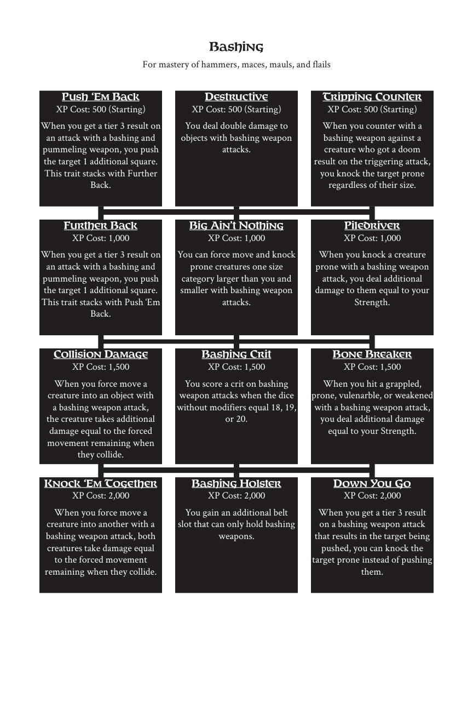

# Bashing

> Source: Crows — Character Booklet, Playtest 3, PDF page(s) 12.

The diagram above preserves the prerequisite connections. Trait text follows in row order.

For mastery of hammers, maces, mauls, and flails

## Push ‘Em Back

**XP Cost:** 500 (Starting)

When you get a tier 3 result on an attack with a bashing and pummeling weapon, you push the target 1 additional square. This trait stacks with Further Back.

## Destructive

**XP Cost:** 500 (Starting)

You deal double damage to objects with bashing weapon attacks.

## Tripping Counter

**XP Cost:** 500 (Starting)

When you counter with a bashing weapon against a creature who got a doom result on the triggering attack, you knock the target prone regardless of their size.

## Further Back

**XP Cost:** 1,000

When you get a tier 3 result on an attack with a bashing and pummeling weapon, you push the target 1 additional square. This trait stacks with Push ‘Em Back.

## Big Ain’t Nothing

**XP Cost:** 1,000

You can force move and knock prone creatures one size category larger than you and smaller with bashing weapon attacks.

## Piledriver

**XP Cost:** 1,000

When you knock a creature prone with a bashing weapon attack, you deal additional damage to them equal to your Strength.

## Collision Damage

**XP Cost:** 1,500

When you force move a creature into an object with a bashing weapon attack, the creature takes additional damage equal to the forced movement remaining when they collide.

## Bashing Crit

**XP Cost:** 1,500

You score a crit on bashing weapon attacks when the dice without modifiers equal 18, 19, or 20.

## Bone Breaker

**XP Cost:** 1,500

When you hit a grappled, prone, vulenarble, or weakened with a bashing weapon attack, you deal additional damage equal to your Strength.

## Knock ‘Em Together

**XP Cost:** 2,000

When you force move a creature into another with a bashing weapon attack, both creatures take damage equal to the forced movement remaining when they collide.

## Bashing Holster

**XP Cost:** 2,000

You gain an additional belt slot that can only hold bashing weapons.

## Down You Go

**XP Cost:** 2,000

When you get a tier 3 result on a bashing weapon attack that results in the target being pushed, you can knock the target prone instead of pushing them.

---

[Index](00-index.md) · [Previous](09-armor.md) · [Next](11-benefaction.md)
