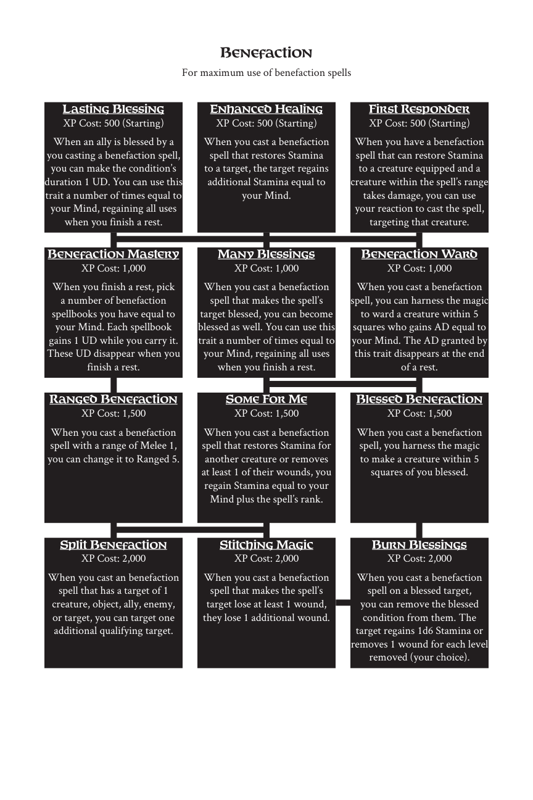

# Benefaction

> Source: Crows — Character Booklet, Playtest 3, PDF page(s) 13.

The diagram above preserves the prerequisite connections. Trait text follows in row order.

For maximum use of benefaction spells

## Lasting Blessing

**XP Cost:** 500 (Starting)

When an ally is blessed by a you casting a benefaction spell, you can make the condition’s duration 1 UD. You can use this trait a number of times equal to your Mind, regaining all uses when you finish a rest.

## Enhanced Healing

**XP Cost:** 500 (Starting)

When you cast a benefaction spell that restores Stamina to a target, the target regains additional Stamina equal to your Mind.

## First Responder

**XP Cost:** 500 (Starting)

When you have a benefaction spell that can restore Stamina to a creature equipped and a creature within the spell’s range takes damage, you can use your reaction to cast the spell, targeting that creature.

## Benefaction Mastery

**XP Cost:** 1,000

When you finish a rest, pick a number of benefaction spellbooks you have equal to your Mind. Each spellbook gains 1 UD while you carry it. These UD disappear when you finish a rest.

## Many Blessings

**XP Cost:** 1,000

When you cast a benefaction spell that makes the spell’s target blessed, you can become blessed as well. You can use this trait a number of times equal to your Mind, regaining all uses when you finish a rest.

## Benefaction Ward

**XP Cost:** 1,000

When you cast a benefaction spell, you can harness the magic to ward a creature within 5 squares who gains AD equal to your Mind. The AD granted by this trait disappears at the end of a rest.

## Ranged Benefaction

**XP Cost:** 1,500

When you cast a benefaction spell with a range of Melee 1, you can change it to Ranged 5.

## Some For Me

**XP Cost:** 1,500

When you cast a benefaction spell that restores Stamina for another creature or removes at least 1 of their wounds, you regain Stamina equal to your Mind plus the spell’s rank.

## Blessed Benefaction

**XP Cost:** 1,500

When you cast a benefaction spell, you harness the magic to make a creature within 5 squares of you blessed.

## Split Benefaction

**XP Cost:** 2,000

When you cast an benefaction spell that has a target of 1 creature, object, ally, enemy, or target, you can target one additional qualifying target.

## Stitching Magic

**XP Cost:** 2,000

When you cast a benefaction spell that makes the spell’s target lose at least 1 wound, they lose 1 additional wound.

## Burn Blessings

**XP Cost:** 2,000

When you cast a benefaction spell on a blessed target, you can remove the blessed condition from them. The target regains 1d6 Stamina or removes 1 wound for each level removed (your choice).

---

[Index](00-index.md) · [Previous](10-bashing.md) · [Next](12-blackmsithing.md)
