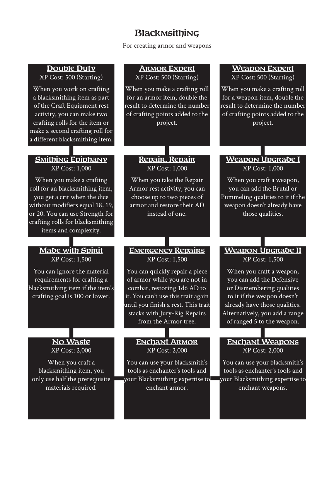

# Blackmsithing

> Source: Crows — Character Booklet, Playtest 3, PDF page(s) 14.

The diagram above preserves the prerequisite connections. Trait text follows in row order.

For creating armor and weapons

## Double Duty

**XP Cost:** 500 (Starting)

When you work on crafting a blacksmithing item as part of the Craft Equipment rest activity, you can make two crafting rolls for the item or make a second crafting roll for a different blacksmithing item.

## Armor Expert

**XP Cost:** 500 (Starting)

When you make a crafting roll for an armor item, double the result to determine the number of crafting points added to the project.

## Weapon Expert

**XP Cost:** 500 (Starting)

When you make a crafting roll for a weapon item, double the result to determine the number of crafting points added to the project.

## Smithing Epiphany

**XP Cost:** 1,000

When you make a crafting roll for an blacksmithing item, you get a crit when the dice without modifiers equal 18, 19, or 20. You can use Strength for crafting rolls for blacksmithing items and complexity.

## Repair, Repair

**XP Cost:** 1,000

When you take the Repair Armor rest activity, you can choose up to two pieces of armor and restore their AD instead of one.

## Weapon Upgrade I

**XP Cost:** 1,000

When you craft a weapon, you can add the Brutal or Pummeling qualities to it if the weapon doesn’t already have those qualities.

## Made with Spirit

**XP Cost:** 1,500

You can ignore the material requirements for crafting a blacksmithing item if the item’s crafting goal is 100 or lower.

## Emergency Repairs

**XP Cost:** 1,500

You can quickly repair a piece of armor while you are not in combat, restoring 1d6 AD to it. You can’t use this trait again until you finish a rest. This trait stacks with Jury-Rig Repairs from the Armor tree.

## Weapon Upgrade II

**XP Cost:** 1,500

When you craft a weapon, you can add the Defensive or Dismembering qualities to it if the weapon doesn’t already have those qualities. Alternatively, you add a range of ranged 5 to the weapon.

## No Waste

**XP Cost:** 2,000

When you craft a blacksmithing item, you only use half the prerequisite materials required.

## Enchant Armor

**XP Cost:** 2,000

You can use your blacksmith’s tools as enchanter’s tools and your Blacksmithing expertise to enchant armor.

## Enchant Weapons

**XP Cost:** 2,000

You can use your blacksmith’s tools as enchanter’s tools and your Blacksmithing expertise to enchant weapons.

---

[Index](00-index.md) · [Previous](11-benefaction.md) · [Next](13-camping.md)
