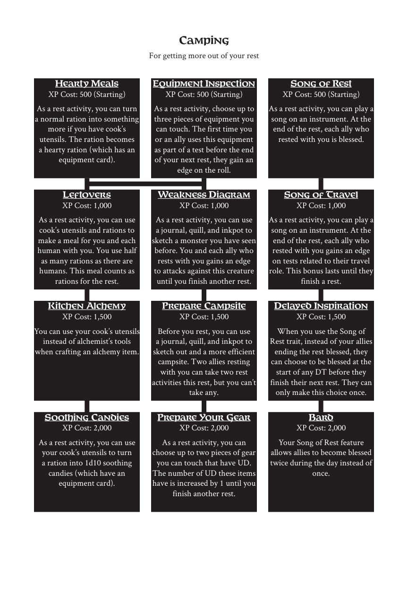

# Camping

> Source: Crows — Character Booklet, Playtest 3, PDF page(s) 15.

The diagram above preserves the prerequisite connections. Trait text follows in row order.

For getting more out of your rest

## Hearty Meals

**XP Cost:** 500 (Starting)

As a rest activity, you can turn a normal ration into something more if you have cook’s utensils. The ration becomes a hearty ration (which has an equipment card).

## Equipment Inspection

**XP Cost:** 500 (Starting)

As a rest activity, choose up to three pieces of equipment you can touch. The first time you or an ally uses this equipment as part of a test before the end of your next rest, they gain an edge on the roll.

## Song of Rest

**XP Cost:** 500 (Starting)

As a rest activity, you can play a song on an instrument. At the end of the rest, each ally who rested with you is blessed.

## Leftovers

**XP Cost:** 1,000

As a rest activity, you can use cook’s utensils and rations to make a meal for you and each human with you. You use half as many rations as there are humans. This meal counts as rations for the rest.

## Weakness Diagram

**XP Cost:** 1,000

As a rest activity, you can use a journal, quill, and inkpot to sketch a monster you have seen before. You and each ally who rests with you gains an edge to attacks against this creature until you finish another rest.

## Song of Travel

**XP Cost:** 1,000

As a rest activity, you can play a song on an instrument. At the end of the rest, each ally who rested with you gains an edge on tests related to their travel role. This bonus lasts until they finish a rest.

## Kitchen Alchemy

**XP Cost:** 1,500

You can use your cook’s utensils instead of alchemist’s tools when crafting an alchemy item.

## Prepare Campsite

**XP Cost:** 1,500

Before you rest, you can use a journal, quill, and inkpot to sketch out and a more efficient campsite. Two allies resting with you can take two rest activities this rest, but you can’t take any.

## Delayed Inspiration

**XP Cost:** 1,500

When you use the Song of Rest trait, instead of your allies ending the rest blessed, they can choose to be blessed at the start of any DT before they finish their next rest. They can only make this choice once.

## Soothing Candies

**XP Cost:** 2,000

As a rest activity, you can use your cook’s utensils to turn a ration into 1d10 soothing candies (which have an equipment card).

## Prepare Your Gear

**XP Cost:** 2,000

As a rest activity, you can choose up to two pieces of gear you can touch that have UD. The number of UD these items have is increased by 1 until you finish another rest.

## Bard

**XP Cost:** 2,000

Your Song of Rest feature allows allies to become blessed twice during the day instead of once.

---

[Index](00-index.md) · [Previous](12-blackmsithing.md) · [Next](14-chopping.md)
