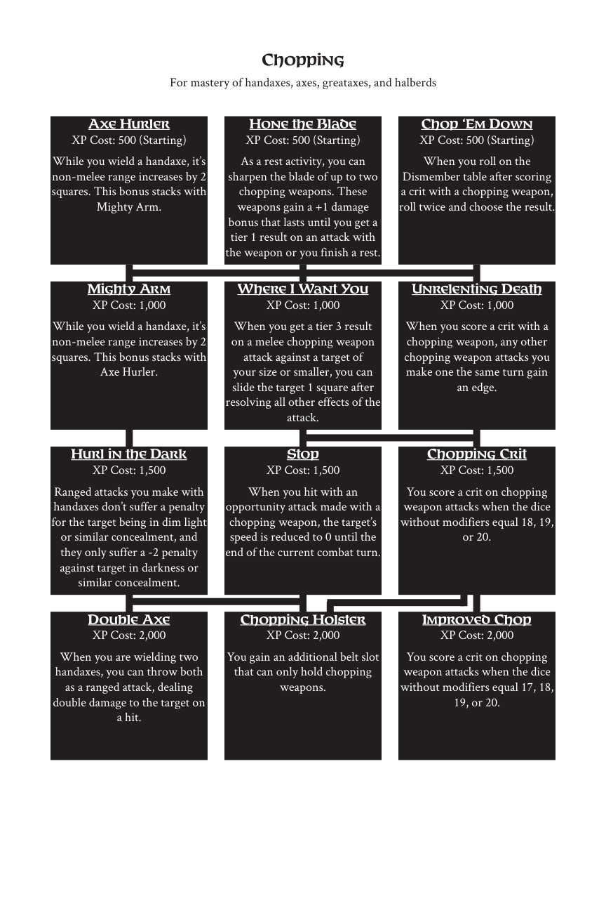

# Chopping

> Source: Crows — Character Booklet, Playtest 3, PDF page(s) 16.

The diagram above preserves the prerequisite connections. Trait text follows in row order.

For mastery of handaxes, axes, greataxes, and halberds

## Axe Hurler

**XP Cost:** 500 (Starting)

While you wield a handaxe, it’s non-melee range increases by 2 squares. This bonus stacks with Mighty Arm.

## Hone the Blade

**XP Cost:** 500 (Starting)

As a rest activity, you can sharpen the blade of up to two chopping weapons. These weapons gain a +1 damage bonus that lasts until you get a tier 1 result on an attack with the weapon or you finish a rest.

## Chop ‘Em Down

**XP Cost:** 500 (Starting)

When you roll on the Dismember table after scoring a crit with a chopping weapon, roll twice and choose the result.

## Mighty Arm

**XP Cost:** 1,000

While you wield a handaxe, it’s non-melee range increases by 2 squares. This bonus stacks with Axe Hurler.

## Where I Want You

**XP Cost:** 1,000

When you get a tier 3 result on a melee chopping weapon attack against a target of your size or smaller, you can slide the target 1 square after resolving all other effects of the attack.

## Unrelenting Death

**XP Cost:** 1,000

When you score a crit with a chopping weapon, any other chopping weapon attacks you make one the same turn gain an edge.

## Hurl in the Dark

**XP Cost:** 1,500

Ranged attacks you make with handaxes don’t suffer a penalty for the target being in dim light or similar concealment, and they only suffer a -2 penalty against target in darkness or similar concealment.

## Stop

**XP Cost:** 1,500

When you hit with an opportunity attack made with a chopping weapon, the target’s speed is reduced to 0 until the end of the current combat turn.

## Chopping Crit

**XP Cost:** 1,500

You score a crit on chopping weapon attacks when the dice without modifiers equal 18, 19, or 20.

## Double Axe

**XP Cost:** 2,000

When you are wielding two handaxes, you can throw both as a ranged attack, dealing double damage to the target on a hit.

## Chopping Holster

**XP Cost:** 2,000

You gain an additional belt slot that can only hold chopping weapons.

## Improved Chop

**XP Cost:** 2,000

You score a crit on chopping weapon attacks when the dice without modifiers equal 17, 18, 19, or 20.

---

[Index](00-index.md) · [Previous](13-camping.md) · [Next](15-conjuration.md)
