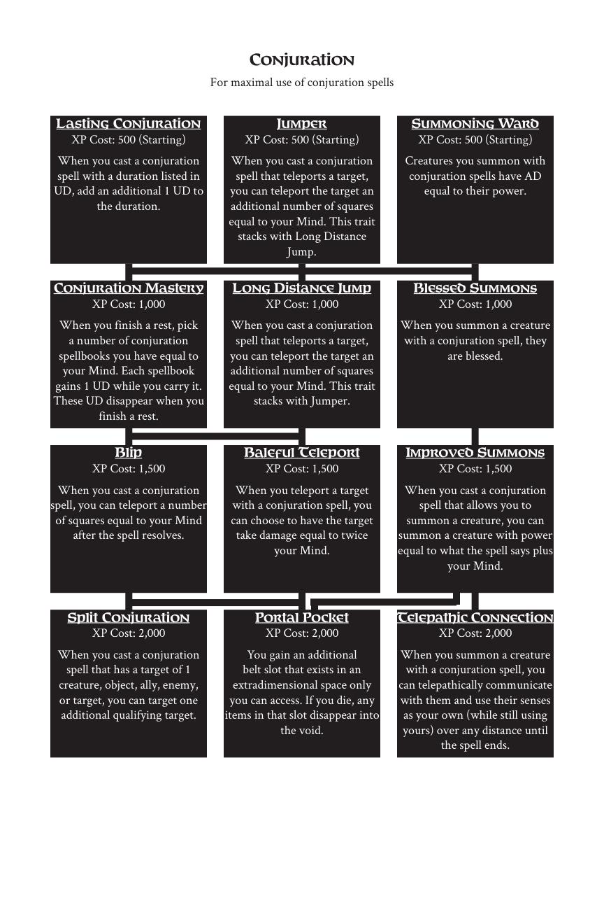

# Conjuration

> Source: Crows — Character Booklet, Playtest 3, PDF page(s) 17.

The diagram above preserves the prerequisite connections. Trait text follows in row order.

For maximal use of conjuration spells

## Lasting Conjuration

**XP Cost:** 500 (Starting)

When you cast a conjuration spell with a duration listed in UD, add an additional 1 UD to the duration.

## Jumper

**XP Cost:** 500 (Starting)

When you cast a conjuration spell that teleports a target, you can teleport the target an additional number of squares equal to your Mind. This trait stacks with Long Distance Jump.

## Summoning Ward

**XP Cost:** 500 (Starting)

Creatures you summon with conjuration spells have AD equal to their power.

## Conjuration Mastery

**XP Cost:** 1,000

When you finish a rest, pick a number of conjuration spellbooks you have equal to your Mind. Each spellbook gains 1 UD while you carry it. These UD disappear when you finish a rest.

## Long Distance Jump

**XP Cost:** 1,000

When you cast a conjuration spell that teleports a target, you can teleport the target an additional number of squares equal to your Mind. This trait stacks with Jumper.

## Blessed Summons

**XP Cost:** 1,000

When you summon a creature with a conjuration spell, they are blessed.

## Blip

**XP Cost:** 1,500

When you cast a conjuration spell, you can teleport a number of squares equal to your Mind after the spell resolves.

## Baleful Teleport

**XP Cost:** 1,500

When you teleport a target with a conjuration spell, you can choose to have the target take damage equal to twice your Mind.

## Improved Summons

**XP Cost:** 1,500

When you cast a conjuration spell that allows you to summon a creature, you can summon a creature with power equal to what the spell says plus your Mind.

## Split Conjuration

**XP Cost:** 2,000

When you cast a conjuration spell that has a target of 1 creature, object, ally, enemy, or target, you can target one additional qualifying target.

## Portal Pocket

**XP Cost:** 2,000

You gain an additional belt slot that exists in an extradimensional space only you can access. If you die, any items in that slot disappear into the void.

## Telepathic Connection

**XP Cost:** 2,000

When you summon a creature with a conjuration spell, you can telepathically communicate with them and use their senses as your own (while still using yours) over any distance until the spell ends.

---

[Index](00-index.md) · [Previous](14-chopping.md) · [Next](16-elemental.md)
