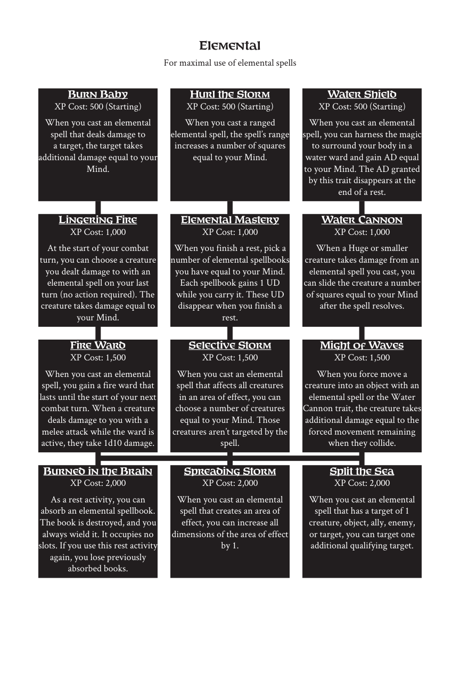

# Elemental

> Source: Crows — Character Booklet, Playtest 3, PDF page(s) 18.

The diagram above preserves the prerequisite connections. Trait text follows in row order.

For maximal use of elemental spells

## Burn Baby

**XP Cost:** 500 (Starting)

When you cast an elemental spell that deals damage to a target, the target takes additional damage equal to your Mind.

## Hurl the Storm

**XP Cost:** 500 (Starting)

When you cast a ranged elemental spell, the spell’s range increases a number of squares equal to your Mind.

## Water Shield

**XP Cost:** 500 (Starting)

When you cast an elemental spell, you can harness the magic to surround your body in a water ward and gain AD equal to your Mind. The AD granted by this trait disappears at the end of a rest.

## Lingering Fire

**XP Cost:** 1,000

At the start of your combat turn, you can choose a creature you dealt damage to with an elemental spell on your last turn (no action required). The creature takes damage equal to your Mind.

## Elemental Mastery

**XP Cost:** 1,000

When you finish a rest, pick a number of elemental spellbooks you have equal to your Mind. Each spellbook gains 1 UD while you carry it. These UD disappear when you finish a rest.

## Water Cannon

**XP Cost:** 1,000

When a Huge or smaller creature takes damage from an elemental spell you cast, you can slide the creature a number of squares equal to your Mind after the spell resolves.

## Fire Ward

**XP Cost:** 1,500

When you cast an elemental spell, you gain a fire ward that lasts until the start of your next combat turn. When a creature deals damage to you with a melee attack while the ward is active, they take 1d10 damage.

## Selective Storm

**XP Cost:** 1,500

When you cast an elemental spell that affects all creatures in an area of effect, you can choose a number of creatures equal to your Mind. Those creatures aren’t targeted by the spell.

## Might of Waves

**XP Cost:** 1,500

When you force move a creature into an object with an elemental spell or the Water Cannon trait, the creature takes additional damage equal to the forced movement remaining when they collide.

## Burned in the Brain

**XP Cost:** 2,000

As a rest activity, you can absorb an elemental spellbook. The book is destroyed, and you always wield it. It occupies no slots. If you use this rest activity again, you lose previously absorbed books.

## Spreading Storm

**XP Cost:** 2,000

When you cast an elemental spell that creates an area of effect, you can increase all dimensions of the area of effect by 1.

## Split the Sea

**XP Cost:** 2,000

When you cast an elemental spell that has a target of 1 creature, object, ally, enemy, or target, you can target one additional qualifying target.

---

[Index](00-index.md) · [Previous](15-conjuration.md) · [Next](17-enchantment.md)
