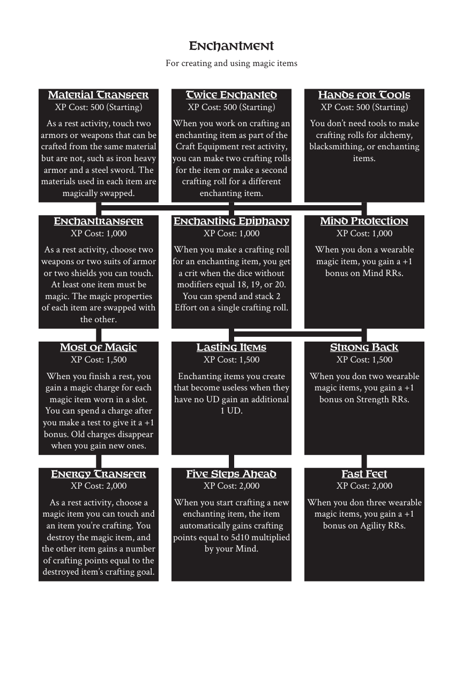

# Enchantment

> Source: Crows — Character Booklet, Playtest 3, PDF page(s) 19.

The diagram above preserves the prerequisite connections. Trait text follows in row order.

For creating and using magic items

## Material Transfer

**XP Cost:** 500 (Starting)

As a rest activity, touch two armors or weapons that can be crafted from the same material but are not, such as iron heavy armor and a steel sword. The materials used in each item are magically swapped.

## Twice Enchanted

**XP Cost:** 500 (Starting)

When you work on crafting an enchanting item as part of the Craft Equipment rest activity, you can make two crafting rolls for the item or make a second crafting roll for a different enchanting item.

## Hands for Tools

**XP Cost:** 500 (Starting)

You don’t need tools to make crafting rolls for alchemy, blacksmithing, or enchanting items.

## Enchantransfer

**XP Cost:** 1,000

As a rest activity, choose two weapons or two suits of armor or two shields you can touch. At least one item must be magic. The magic properties of each item are swapped with the other.

## Enchanting Epiphany

**XP Cost:** 1,000

When you make a crafting roll for an enchanting item, you get a crit when the dice without modifiers equal 18, 19, or 20. You can spend and stack 2 Effort on a single crafting roll.

## Mind Protection

**XP Cost:** 1,000

When you don a wearable magic item, you gain a +1 bonus on Mind RRs.

## Most of Magic

**XP Cost:** 1,500

When you finish a rest, you gain a magic charge for each magic item worn in a slot. You can spend a charge after you make a test to give it a +1 bonus. Old charges disappear when you gain new ones.

## Lasting Items

**XP Cost:** 1,500

Enchanting items you create that become useless when they have no UD gain an additional 1 UD.

## Strong Back

**XP Cost:** 1,500

When you don two wearable magic items, you gain a +1 bonus on Strength RRs.

## Energy Transfer

**XP Cost:** 2,000

As a rest activity, choose a magic item you can touch and an item you’re crafting. You destroy the magic item, and the other item gains a number of crafting points equal to the destroyed item’s crafting goal.

## Five Steps Ahead

**XP Cost:** 2,000

When you start crafting a new enchanting item, the item automatically gains crafting points equal to 5d10 multiplied by your Mind.

## Fast Feet

**XP Cost:** 2,000

When you don three wearable magic items, you gain a +1 bonus on Agility RRs.

---

[Index](00-index.md) · [Previous](16-elemental.md) · [Next](18-illusion.md)
