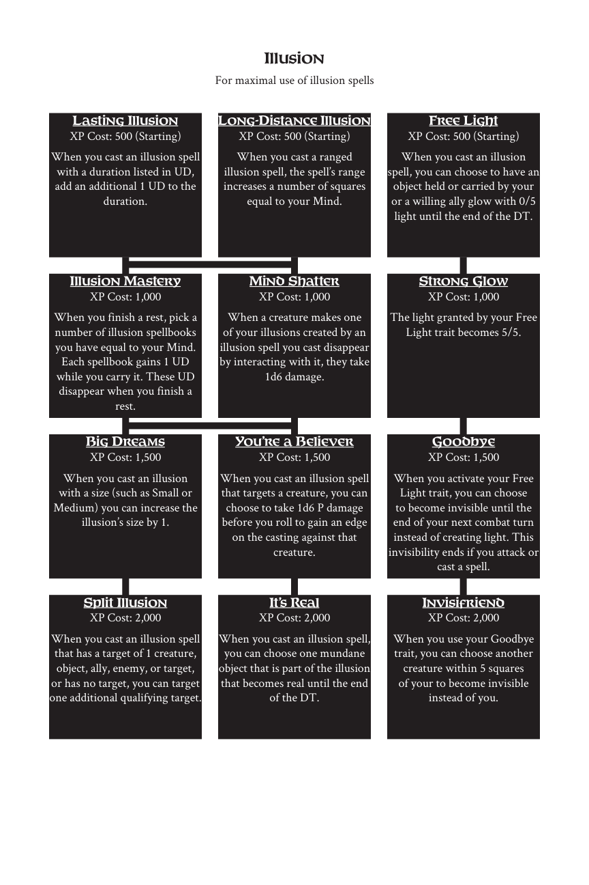

# Illusion

> Source: Crows — Character Booklet, Playtest 3, PDF page(s) 20.

The diagram above preserves the prerequisite connections. Trait text follows in row order.

For maximal use of illusion spells

## Lasting Illusion

**XP Cost:** 500 (Starting)

When you cast an illusion spell with a duration listed in UD, add an additional 1 UD to the duration.

## Long-Distance Illusion

**XP Cost:** 500 (Starting)

When you cast a ranged illusion spell, the spell’s range increases a number of squares equal to your Mind.

## Free Light

**XP Cost:** 500 (Starting)

When you cast an illusion spell, you can choose to have an object held or carried by your or a willing ally glow with 0/5 light until the end of the DT.

## Illusion Mastery

**XP Cost:** 1,000

When you finish a rest, pick a number of illusion spellbooks you have equal to your Mind. Each spellbook gains 1 UD while you carry it. These UD disappear when you finish a rest.

## Mind Shatter

**XP Cost:** 1,000

When a creature makes one of your illusions created by an illusion spell you cast disappear by interacting with it, they take 1d6 damage.

## Strong Glow

**XP Cost:** 1,000

The light granted by your Free Light trait becomes 5/5.

## Big Dreams

**XP Cost:** 1,500

When you cast an illusion with a size (such as Small or Medium) you can increase the illusion’s size by 1.

## You’re a Believer

**XP Cost:** 1,500

When you cast an illusion spell that targets a creature, you can choose to take 1d6 P damage before you roll to gain an edge on the casting against that creature.

## Goodbye

**XP Cost:** 1,500

When you activate your Free Light trait, you can choose to become invisible until the end of your next combat turn instead of creating light. This invisibility ends if you attack or cast a spell.

## Split Illusion

**XP Cost:** 2,000

When you cast an illusion spell that has a target of 1 creature, object, ally, enemy, or target, or has no target, you can target one additional qualifying target.

## It’s Real

**XP Cost:** 2,000

When you cast an illusion spell, you can choose one mundane object that is part of the illusion that becomes real until the end of the DT.

## Invisifriend

**XP Cost:** 2,000

When you use your Goodbye trait, you can choose another creature within 5 squares of your to become invisible instead of you.

---

[Index](00-index.md) · [Previous](17-enchantment.md) · [Next](19-knowledge.md)
