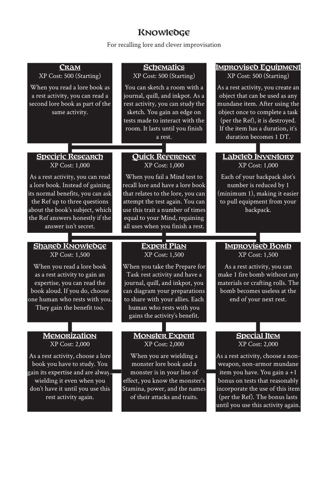

# Knowledge

> Source: Crows — Character Booklet, Playtest 3, PDF page(s) 21.

The diagram above preserves the prerequisite connections. Trait text follows in row order.

For recalling lore and clever improvisation

## Cram

**XP Cost:** 500 (Starting)

When you read a lore book as a rest activity, you can read a second lore book as part of the same activity.

## Schematics

**XP Cost:** 500 (Starting)

You can sketch a room with a journal, quill, and inkpot. As a rest activity, you can study the sketch. You gain an edge on tests made to interact with the room. It lasts until you finish a rest.

## Improvised Equipment

**XP Cost:** 500 (Starting)

As a rest activity, you create an object that can be used as any mundane item. After using the object once to complete a task (per the Ref), it is destroyed. If the item has a duration, it’s duration becomes 1 DT.

## Specific Research

**XP Cost:** 1,000

As a rest activity, you can read a lore book. Instead of gaining its normal benefits, you can ask the Ref up to three questions about the book’s subject, which the Ref answers honestly if the answer isn’t secret.

## Quick Reference

**XP Cost:** 1,000

When you fail a Mind test to recall lore and have a lore book that relates to the lore, you can attempt the test again. You can use this trait a number of times equal to your Mind, regaining all uses when you finish a rest.

## Labeled Inventory

**XP Cost:** 1,000

Each of your backpack slot’s number is reduced by 1 (minimum 1), making it easier to pull equipment from your backpack.

## Shared Knowledge

**XP Cost:** 1,500

When you read a lore book as a rest activity to gain an expertise, you can read the book aloud. If you do, choose one human who rests with you. They gain the benefit too.

## Expert Plan

**XP Cost:** 1,500

When you take the Prepare for Task rest activity and have a journal, quill, and inkpot, you can diagram your preparations to share with your allies. Each human who rests with you gains the activity’s benefit.

## Improvised Bomb

**XP Cost:** 1,500

As a rest activity, you can make 1 fire bomb without any materials or crafting rolls. The bomb becomes useless at the end of your next rest.

## Memorization

**XP Cost:** 2,000

As a rest activity, choose a lore book you have to study. You gain its expertise and are always wielding it even when you don’t have it until you use this rest activity again.

## Monster Expert

**XP Cost:** 2,000

When you are wielding a monster lore book and a monster is in your line of effect, you know the monster’s Stamina, power, and the names of their attacks and traits.

## Special Item

**XP Cost:** 2,000

As a rest activity, choose a nonweapon, non-armor mundane item you have. You gain a +1 bonus on tests that reasonably incorporate the use of this item (per the Ref). The bonus lasts until you use this activity again.

---

[Index](00-index.md) · [Previous](18-illusion.md) · [Next](20-leverage.md)
