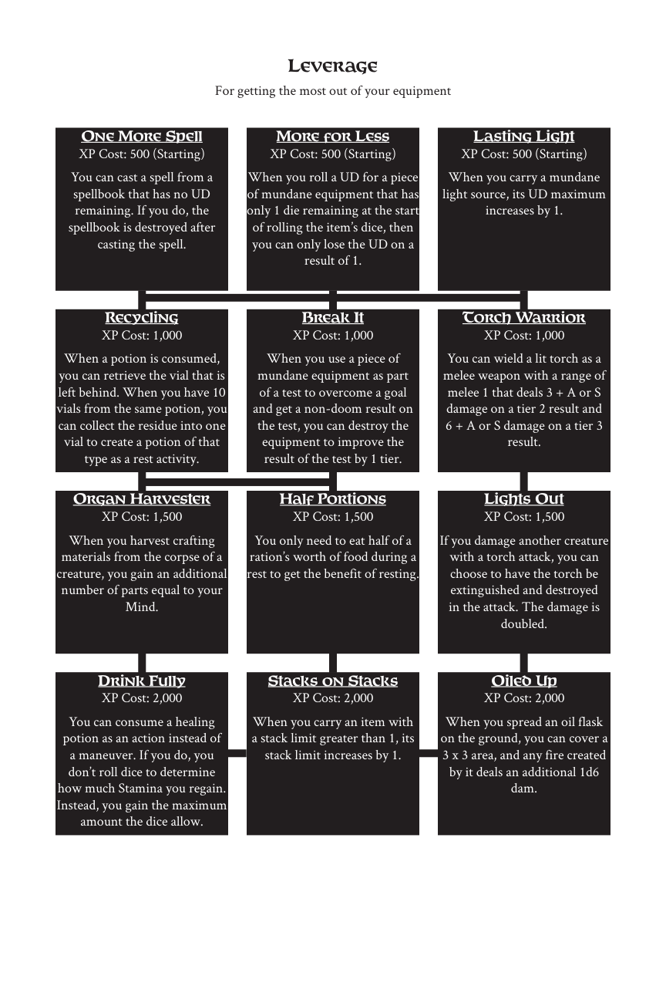

# Leverage

> Source: Crows — Character Booklet, Playtest 3, PDF page(s) 22.

The diagram above preserves the prerequisite connections. Trait text follows in row order.

For getting the most out of your equipment

## One More Spell

**XP Cost:** 500 (Starting)

You can cast a spell from a spellbook that has no UD remaining. If you do, the spellbook is destroyed after casting the spell.

## More for Less

**XP Cost:** 500 (Starting)

When you roll a UD for a piece of mundane equipment that has only 1 die remaining at the start of rolling the item’s dice, then you can only lose the UD on a result of 1.

## Lasting Light

**XP Cost:** 500 (Starting)

When you carry a mundane light source, its UD maximum increases by 1.

## Recycling

**XP Cost:** 1,000

When a potion is consumed, you can retrieve the vial that is left behind. When you have 10 vials from the same potion, you can collect the residue into one vial to create a potion of that type as a rest activity.

## Break It

**XP Cost:** 1,000

When you use a piece of mundane equipment as part of a test to overcome a goal and get a non-doom result on the test, you can destroy the equipment to improve the result of the test by 1 tier.

## Torch Warrior

**XP Cost:** 1,000

You can wield a lit torch as a melee weapon with a range of melee 1 that deals 3 + A or S damage on a tier 2 result and 6 + A or S damage on a tier 3 result.

## Organ Harvester

**XP Cost:** 1,500

When you harvest crafting materials from the corpse of a creature, you gain an additional number of parts equal to your Mind.

## Half Portions

**XP Cost:** 1,500

You only need to eat half of a ration’s worth of food during a rest to get the benefit of resting.

## Lights Out

**XP Cost:** 1,500

If you damage another creature with a torch attack, you can choose to have the torch be extinguished and destroyed in the attack. The damage is doubled.

## Drink Fully

**XP Cost:** 2,000

You can consume a healing potion as an action instead of a maneuver. If you do, you don’t roll dice to determine how much Stamina you regain. Instead, you gain the maximum amount the dice allow.

## Stacks on Stacks

**XP Cost:** 2,000

When you carry an item with a stack limit greater than 1, its stack limit increases by 1.

## Oiled Up

**XP Cost:** 2,000

When you spread an oil flask on the ground, you can cover a 3 x 3 area, and any fire created by it deals an additional 1d6 dam.

---

[Index](00-index.md) · [Previous](19-knowledge.md) · [Next](21-necromancy.md)
