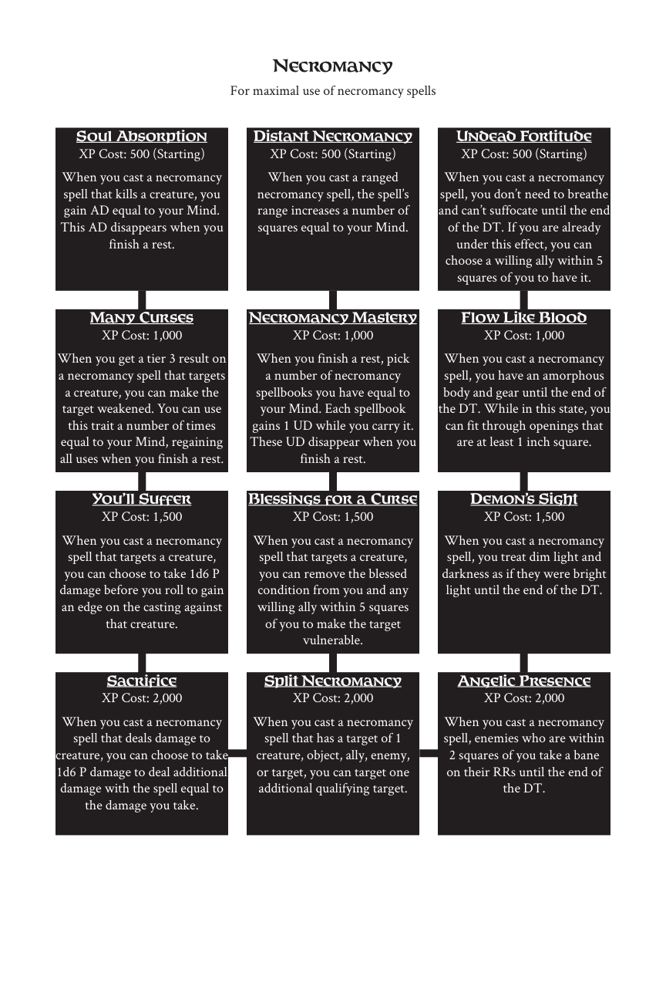

# Necromancy

> Source: Crows — Character Booklet, Playtest 3, PDF page(s) 23.

The diagram above preserves the prerequisite connections. Trait text follows in row order.

For maximal use of necromancy spells

## Soul Absorption

**XP Cost:** 500 (Starting)

When you cast a necromancy spell that kills a creature, you gain AD equal to your Mind. This AD disappears when you finish a rest.

## Distant Necromancy

**XP Cost:** 500 (Starting)

When you cast a ranged necromancy spell, the spell’s range increases a number of squares equal to your Mind.

## Undead Fortitude

**XP Cost:** 500 (Starting)

When you cast a necromancy spell, you don’t need to breathe and can’t suffocate until the end of the DT. If you are already under this effect, you can choose a willing ally within 5 squares of you to have it.

## Many Curses

**XP Cost:** 1,000

When you get a tier 3 result on a necromancy spell that targets a creature, you can make the target weakened. You can use this trait a number of times equal to your Mind, regaining all uses when you finish a rest.

## Necromancy Mastery

**XP Cost:** 1,000

When you finish a rest, pick a number of necromancy spellbooks you have equal to your Mind. Each spellbook gains 1 UD while you carry it. These UD disappear when you finish a rest.

## Flow Like Blood

**XP Cost:** 1,000

When you cast a necromancy spell, you have an amorphous body and gear until the end of the DT. While in this state, you can fit through openings that are at least 1 inch square.

## You’ll Suffer

**XP Cost:** 1,500

When you cast a necromancy spell that targets a creature, you can choose to take 1d6 P damage before you roll to gain an edge on the casting against that creature.

## Blessings for a Curse

**XP Cost:** 1,500

When you cast a necromancy spell that targets a creature, you can remove the blessed condition from you and any willing ally within 5 squares of you to make the target vulnerable.

## Demon’s Sight

**XP Cost:** 1,500

When you cast a necromancy spell, you treat dim light and darkness as if they were bright light until the end of the DT.

## Sacrifice

**XP Cost:** 2,000

When you cast a necromancy spell that deals damage to creature, you can choose to take 1d6 P damage to deal additional damage with the spell equal to the damage you take.

## Split Necromancy

**XP Cost:** 2,000

When you cast a necromancy spell that has a target of 1 creature, object, ally, enemy, or target, you can target one additional qualifying target.

## Angelic Presence

**XP Cost:** 2,000

When you cast a necromancy spell, enemies who are within 2 squares of you take a bane on their RRs until the end of the DT.

---

[Index](00-index.md) · [Previous](20-leverage.md) · [Next](22-pets.md)
