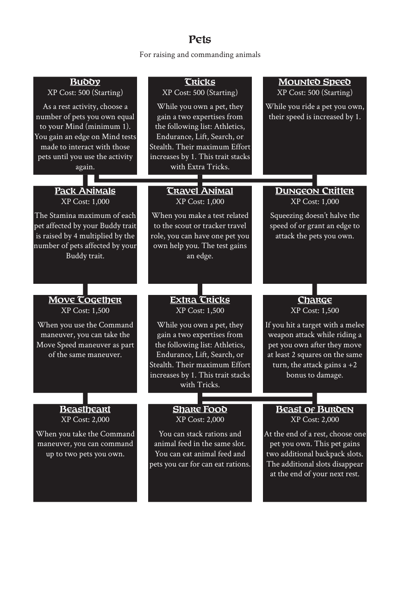

# Pets

> Source: Crows — Character Booklet, Playtest 3, PDF page(s) 24.

The diagram above preserves the prerequisite connections. Trait text follows in row order.

For raising and commanding animals

## Buddy

**XP Cost:** 500 (Starting)

As a rest activity, choose a number of pets you own equal to your Mind (minimum 1). You gain an edge on Mind tests made to interact with those pets until you use the activity again.

## Tricks

**XP Cost:** 500 (Starting)

While you own a pet, they gain a two expertises from the following list: Athletics, Endurance, Lift, Search, or Stealth. Their maximum Effort increases by 1. This trait stacks with Extra Tricks.

## Mounted Speed

**XP Cost:** 500 (Starting)

While you ride a pet you own, their speed is increased by 1.

## Pack Animals

**XP Cost:** 1,000

The Stamina maximum of each pet affected by your Buddy trait is raised by 4 multiplied by the number of pets affected by your Buddy trait.

## Travel Animal

**XP Cost:** 1,000

When you make a test related to the scout or tracker travel role, you can have one pet you own help you. The test gains an edge.

## Dungeon Critter

**XP Cost:** 1,000

Squeezing doesn’t halve the speed of or grant an edge to attack the pets you own.

## Move Together

**XP Cost:** 1,500

When you use the Command maneuver, you can take the Move Speed maneuver as part of the same maneuver.

## Extra Tricks

**XP Cost:** 1,500

While you own a pet, they gain a two expertises from the following list: Athletics, Endurance, Lift, Search, or Stealth. Their maximum Effort increases by 1. This trait stacks with Tricks.

## Charge

**XP Cost:** 1,500

If you hit a target with a melee weapon attack while riding a pet you own after they move at least 2 squares on the same turn, the attack gains a +2 bonus to damage.

## Beastheart

**XP Cost:** 2,000

When you take the Command maneuver, you can command up to two pets you own.

## Share Food

**XP Cost:** 2,000

You can stack rations and animal feed in the same slot. You can eat animal feed and pets you car for can eat rations.

## Beast of Burden

**XP Cost:** 2,000

At the end of a rest, choose one pet you own. This pet gains two additional backpack slots. The additional slots disappear at the end of your next rest.

---

[Index](00-index.md) · [Previous](21-necromancy.md) · [Next](23-reputation.md)
