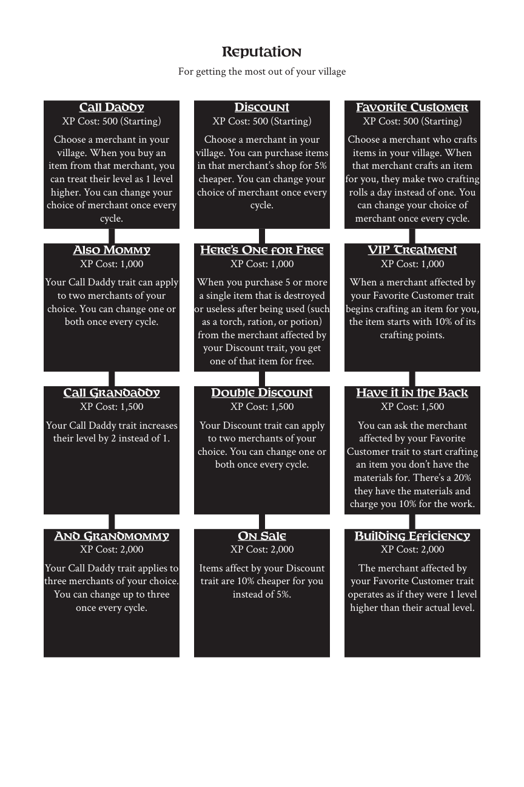

# Reputation

> Source: Crows — Character Booklet, Playtest 3, PDF page(s) 25.

The diagram above preserves the prerequisite connections. Trait text follows in row order.

For getting the most out of your village

## Call Daddy

**XP Cost:** 500 (Starting)

Choose a merchant in your village. When you buy an item from that merchant, you can treat their level as 1 level higher. You can change your choice of merchant once every cycle.

## Discount

**XP Cost:** 500 (Starting)

Choose a merchant in your village. You can purchase items in that merchant’s shop for 5% cheaper. You can change your choice of merchant once every cycle.

## Favorite Customer

**XP Cost:** 500 (Starting)

Choose a merchant who crafts items in your village. When that merchant crafts an item for you, they make two crafting rolls a day instead of one. You can change your choice of merchant once every cycle.

## Also Mommy

**XP Cost:** 1,000

Your Call Daddy trait can apply to two merchants of your choice. You can change one or both once every cycle.

## Here’s One for Free

**XP Cost:** 1,000

When you purchase 5 or more a single item that is destroyed or useless after being used (such as a torch, ration, or potion) from the merchant affected by your Discount trait, you get one of that item for free.

## VIP Treatment

**XP Cost:** 1,000

When a merchant affected by your Favorite Customer trait begins crafting an item for you, the item starts with 10% of its crafting points.

## Call Grandaddy

**XP Cost:** 1,500

Your Call Daddy trait increases their level by 2 instead of 1.

## Double Discount

**XP Cost:** 1,500

Your Discount trait can apply to two merchants of your choice. You can change one or both once every cycle.

## Have it in the Back

**XP Cost:** 1,500

You can ask the merchant affected by your Favorite Customer trait to start crafting an item you don’t have the materials for. There’s a 20% they have the materials and charge you 10% for the work.

## And Grandmommy

**XP Cost:** 2,000

Your Call Daddy trait applies to three merchants of your choice. You can change up to three once every cycle.

## On Sale

**XP Cost:** 2,000

Items affect by your Discount trait are 10% cheaper for you instead of 5%.

## Building Efficiency

**XP Cost:** 2,000

The merchant affected by your Favorite Customer trait operates as if they were 1 level higher than their actual level.

---

[Index](00-index.md) · [Previous](22-pets.md) · [Next](24-slashing.md)
