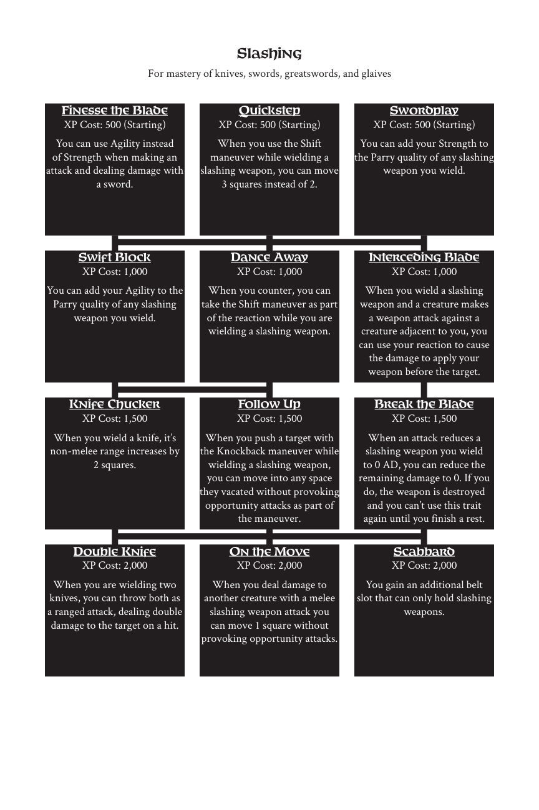

# Slashing

> Source: Crows — Character Booklet, Playtest 3, PDF page(s) 26.

The diagram above preserves the prerequisite connections. Trait text follows in row order.

For mastery of knives, swords, greatswords, and glaives

## Finesse the Blade

**XP Cost:** 500 (Starting)

You can use Agility instead of Strength when making an attack and dealing damage with a sword.

## Quickstep

**XP Cost:** 500 (Starting)

When you use the Shift maneuver while wielding a slashing weapon, you can move 3 squares instead of 2.

## Swordplay

**XP Cost:** 500 (Starting)

You can add your Strength to the Parry quality of any slashing weapon you wield.

## Swift Block

**XP Cost:** 1,000

You can add your Agility to the Parry quality of any slashing weapon you wield.

## Dance Away

**XP Cost:** 1,000

When you counter, you can take the Shift maneuver as part of the reaction while you are wielding a slashing weapon.

## Interceding Blade

**XP Cost:** 1,000

When you wield a slashing weapon and a creature makes a weapon attack against a creature adjacent to you, you can use your reaction to cause the damage to apply your weapon before the target.

## Knife Chucker

**XP Cost:** 1,500

When you wield a knife, it’s non-melee range increases by 2 squares.

## Follow Up

**XP Cost:** 1,500

When you push a target with the Knockback maneuver while wielding a slashing weapon, you can move into any space they vacated without provoking opportunity attacks as part of the maneuver.

## Break the Blade

**XP Cost:** 1,500

When an attack reduces a slashing weapon you wield to 0 AD, you can reduce the remaining damage to 0. If you do, the weapon is destroyed and you can’t use this trait again until you finish a rest.

## Double Knife

**XP Cost:** 2,000

When you are wielding two knives, you can throw both as a ranged attack, dealing double damage to the target on a hit.

## On the Move

**XP Cost:** 2,000

When you deal damage to another creature with a melee slashing weapon attack you can move 1 square without provoking opportunity attacks.

## Scabbard

**XP Cost:** 2,000

You gain an additional belt slot that can only hold slashing weapons.

---

[Index](00-index.md) · [Previous](23-reputation.md) · [Next](25-stabbing.md)
