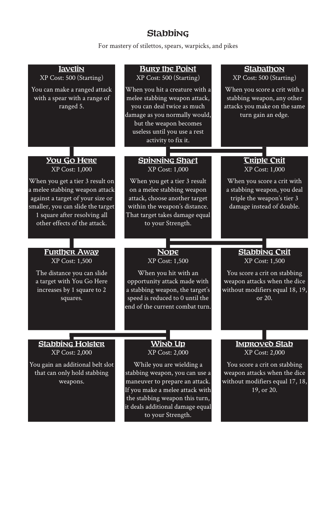

# Stabbing

> Source: Crows — Character Booklet, Playtest 3, PDF page(s) 27.

The diagram above preserves the prerequisite connections. Trait text follows in row order.

For mastery of stilettos, spears, warpicks, and pikes

## Javelin

**XP Cost:** 500 (Starting)

You can make a ranged attack with a spear with a range of ranged 5.

## Bury the Point

**XP Cost:** 500 (Starting)

When you hit a creature with a melee stabbing weapon attack, you can deal twice as much damage as you normally would, but the weapon becomes useless until you use a rest activity to fix it.

## Stabathon

**XP Cost:** 500 (Starting)

When you score a crit with a stabbing weapon, any other attacks you make on the same turn gain an edge.

## You Go Here

**XP Cost:** 1,000

When you get a tier 3 result on a melee stabbing weapon attack against a target of your size or smaller, you can slide the target 1 square after resolving all other effects of the attack.

## Spinning Shaft

**XP Cost:** 1,000

When you get a tier 3 result on a melee stabbing weapon attack, choose another target within the weapon’s distance. That target takes damage equal to your Strength.

## Triple Crit

**XP Cost:** 1,000

When you score a crit with a stabbing weapon, you deal triple the weapon’s tier 3 damage instead of double.

## Further Away

**XP Cost:** 1,500

The distance you can slide a target with You Go Here increases by 1 square to 2 squares.

## Nope

**XP Cost:** 1,500

When you hit with an opportunity attack made with a stabbing weapon, the target’s speed is reduced to 0 until the end of the current combat turn.

## Stabbing Crit

**XP Cost:** 1,500

You score a crit on stabbing weapon attacks when the dice without modifiers equal 18, 19, or 20.

## Stabbing Holster

**XP Cost:** 2,000

You gain an additional belt slot that can only hold stabbing weapons.

## Wind Up

**XP Cost:** 2,000

While you are wielding a stabbing weapon, you can use a maneuver to prepare an attack. If you make a melee attack with the stabbing weapon this turn, it deals additional damage equal to your Strength.

## Improved Stab

**XP Cost:** 2,000

You score a crit on stabbing weapon attacks when the dice without modifiers equal 17, 18, 19, or 20.

---

[Index](00-index.md) · [Previous](24-slashing.md) · [Next](26-thievery.md)
