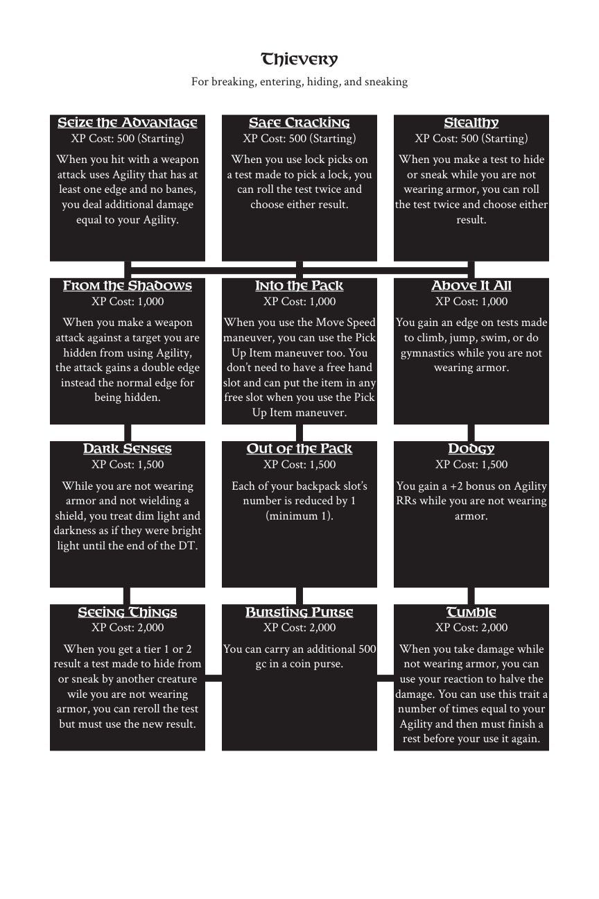

# Thievery

> Source: Crows — Character Booklet, Playtest 3, PDF page(s) 28.

The diagram above preserves the prerequisite connections. Trait text follows in row order.

For breaking, entering, hiding, and sneaking

## Seize the Advantage

**XP Cost:** 500 (Starting)

When you hit with a weapon attack uses Agility that has at least one edge and no banes, you deal additional damage equal to your Agility.

## Safe Cracking

**XP Cost:** 500 (Starting)

When you use lock picks on a test made to pick a lock, you can roll the test twice and choose either result.

## Stealthy

**XP Cost:** 500 (Starting)

When you make a test to hide or sneak while you are not wearing armor, you can roll the test twice and choose either result.

## From the Shadows

**XP Cost:** 1,000

When you make a weapon attack against a target you are hidden from using Agility, the attack gains a double edge instead the normal edge for being hidden.

## Into the Pack

**XP Cost:** 1,000

When you use the Move Speed maneuver, you can use the Pick Up Item maneuver too. You don’t need to have a free hand slot and can put the item in any free slot when you use the Pick Up Item maneuver.

## Above It All

**XP Cost:** 1,000

You gain an edge on tests made to climb, jump, swim, or do gymnastics while you are not wearing armor.

## Dark Senses

**XP Cost:** 1,500

While you are not wearing armor and not wielding a shield, you treat dim light and darkness as if they were bright light until the end of the DT.

## Out of the Pack

**XP Cost:** 1,500

Each of your backpack slot’s number is reduced by 1 (minimum 1).

## Dodgy

**XP Cost:** 1,500

You gain a +2 bonus on Agility RRs while you are not wearing armor.

## Seeing Things

**XP Cost:** 2,000

When you get a tier 1 or 2 result a test made to hide from or sneak by another creature wile you are not wearing armor, you can reroll the test but must use the new result.

## Bursting Purse

**XP Cost:** 2,000

You can carry an additional 500 gc in a coin purse.

## Tumble

**XP Cost:** 2,000

When you take damage while not wearing armor, you can use your reaction to halve the damage. You can use this trait a number of times equal to your Agility and then must finish a rest before your use it again.

---

[Index](00-index.md) · [Previous](25-stabbing.md) · [Next](27-travel.md)
