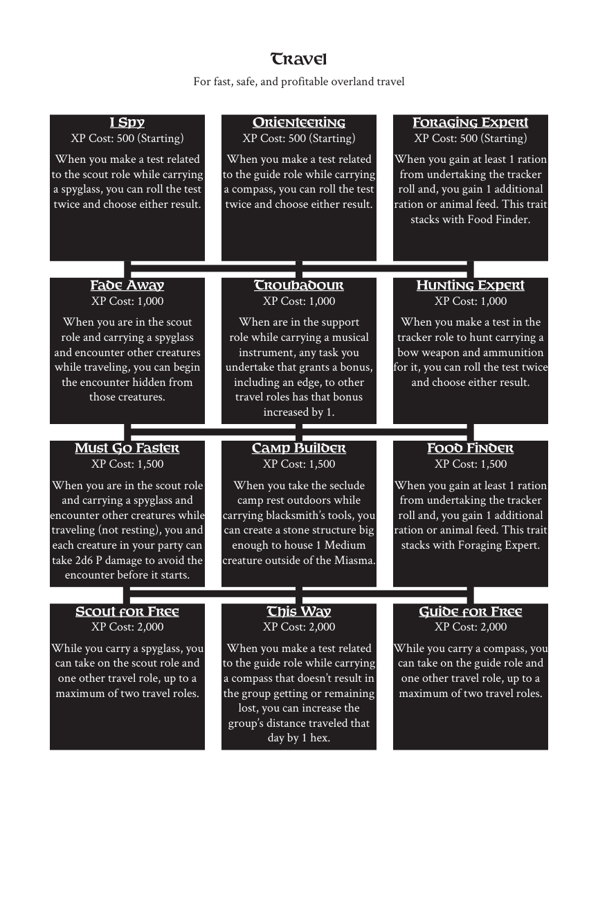

# Travel

> Source: Crows — Character Booklet, Playtest 3, PDF page(s) 29.

The diagram above preserves the prerequisite connections. Trait text follows in row order.

For fast, safe, and profitable overland travel

## I Spy

**XP Cost:** 500 (Starting)

When you make a test related to the scout role while carrying a spyglass, you can roll the test twice and choose either result.

## Orienteering

**XP Cost:** 500 (Starting)

When you make a test related to the guide role while carrying a compass, you can roll the test twice and choose either result.

## Foraging Expert

**XP Cost:** 500 (Starting)

When you gain at least 1 ration from undertaking the tracker roll and, you gain 1 additional ration or animal feed. This trait stacks with Food Finder.

## Fade Away

**XP Cost:** 1,000

When you are in the scout role and carrying a spyglass and encounter other creatures while traveling, you can begin the encounter hidden from those creatures.

## Troubadour

**XP Cost:** 1,000

When are in the support role while carrying a musical instrument, any task you undertake that grants a bonus, including an edge, to other travel roles has that bonus increased by 1.

## Hunting Expert

**XP Cost:** 1,000

When you make a test in the tracker role to hunt carrying a bow weapon and ammunition for it, you can roll the test twice and choose either result.

## Must Go Faster

**XP Cost:** 1,500

When you are in the scout role and carrying a spyglass and encounter other creatures while traveling (not resting), you and each creature in your party can take 2d6 P damage to avoid the encounter before it starts.

## Camp Builder

**XP Cost:** 1,500

When you take the seclude camp rest outdoors while carrying blacksmith’s tools, you can create a stone structure big enough to house 1 Medium creature outside of the Miasma.

## Food Finder

**XP Cost:** 1,500

When you gain at least 1 ration from undertaking the tracker roll and, you gain 1 additional ration or animal feed. This trait stacks with Foraging Expert.

## Scout for Free

**XP Cost:** 2,000

While you carry a spyglass, you can take on the scout role and one other travel role, up to a maximum of two travel roles.

## This Way

**XP Cost:** 2,000

When you make a test related to the guide role while carrying a compass that doesn’t result in the group getting or remaining lost, you can increase the group’s distance traveled that day by 1 hex.

## Guide for Free

**XP Cost:** 2,000

While you carry a compass, you can take on the guide role and one other travel role, up to a maximum of two travel roles.

---

[Index](00-index.md) · [Previous](26-thievery.md) · [Next](28-unarmed.md)
