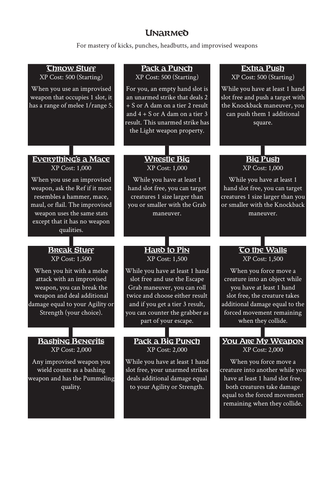

# Unarmed

> Source: Crows — Character Booklet, Playtest 3, PDF page(s) 30.

The diagram above preserves the prerequisite connections. Trait text follows in row order.

For mastery of kicks, punches, headbutts, and improvised weapons

## Throw Stuff

**XP Cost:** 500 (Starting)

When you use an improvised weapon that occupies 1 slot, it has a range of melee 1/range 5.

## Pack a Punch

**XP Cost:** 500 (Starting)

For you, an empty hand slot is an unarmed strike that deals 2 + S or A dam on a tier 2 result and 4 + S or A dam on a tier 3 result. This unarmed strike has the Light weapon property.

## Extra Push

**XP Cost:** 500 (Starting)

While you have at least 1 hand slot free and push a target with the Knockback maneuver, you can push them 1 additional square.

## Everything’s a Mace

**XP Cost:** 1,000

When you use an improvised weapon, ask the Ref if it most resembles a hammer, mace, maul, or flail. The improvised weapon uses the same stats except that it has no weapon qualities.

## Wrestle Big

**XP Cost:** 1,000

While you have at least 1 hand slot free, you can target creatures 1 size larger than you or smaller with the Grab maneuver.

## Big Push

**XP Cost:** 1,000

While you have at least 1 hand slot free, you can target creatures 1 size larger than you or smaller with the Knockback maneuver.

## Break Stuff

**XP Cost:** 1,500

When you hit with a melee attack with an improvised weapon, you can break the weapon and deal additional damage equal to your Agility or Strength (your choice).

## Hard to Pin

**XP Cost:** 1,500

While you have at least 1 hand slot free and use the Escape Grab maneuver, you can roll twice and choose either result and if you get a tier 3 result, you can counter the grabber as part of your escape.

## To the Walls

**XP Cost:** 1,500

When you force move a creature into an object while you have at least 1 hand slot free, the creature takes additional damage equal to the forced movement remaining when they collide.

## Bashing Benefits

**XP Cost:** 2,000

Any improvised weapon you wield counts as a bashing weapon and has the Pummeling quality.

## Pack a Big Punch

**XP Cost:** 2,000

While you have at least 1 hand slot free, your unarmed strikes deals additional damage equal to your Agility or Strength.

## You Are My Weapon

**XP Cost:** 2,000

When you force move a creature into another while you have at least 1 hand slot free, both creatures take damage equal to the forced movement remaining when they collide.

---

[Index](00-index.md) · [Previous](27-travel.md) · [Next](29-equipment.md)
